.. _addons:

Add-ons
=======

Introduction
------------

Add-ons are Docker containers that run on the same system as the *operational layer*.
The :cpp:class:`SystemManager` process maintains the add-ons and can start, stop, and update the add-on at request.
The add-ons in the system are configured in the :ref:`system add-on web app <addon_system_admin_addons>`, using the `Docker Engine API (1.46) <https://docs.docker.com/engine/api/v1.46/>`_ syntax.

The system is shipped with the :ref:`system add-on <addon_system>` and the :ref:`node-red add-on <addon_node_red>`.
The :ref:`task-map add-on <addon_taskmap>` can be added when needed.

Python package
--------------

The ``artof_utils`` Python package supports new Python add-ons. The package provides the interaction with the *operational layer* including:

   1. *ARTOF Redis interface* interaction (``artof_utils.redis``)
   2. Field, traject, polygon and task manipulation (``artof_utils.helpers``)
   3. Platform and implement configuration access, validated with `pydantic <https://docs.pydantic.dev/>`_ schemas (``artof_utils.schemas``)
   4. As-applied session reading and writing (``artof_utils.as_applied``)

.. code-block:: bash

   pip install artof-utils

The package reads the robot configuration from the folder in the ``ILVO_PATH`` environment variable (``/var/lib/ilvo`` on a robot).
You can find the source code of the Python package in the `artof-utils <https://github.com/artof-ilvo/artof-utils>`_ project.

.. _addon_system:

System add-on
-------------

The system add-on is implemented in Python-Django and provides the web application to operate and configure the robot.
It runs on the robot itself (``--network=host``) and is available from any phone, tablet or laptop on the robot's network.
By default, the web application is hosted at port 80 (``PORT`` environment variable).
The source code is in the `artof-system <https://github.com/artof-ilvo/artof-system>`_ project.

The menu bar holds the operator pages *Fields*, *Map*, *Applied* and *Settings*, and on the right the *Admin* area.
The pages adapt to phone screens: the menu collapses and tables are shown as cards.

.. warning::

   Many controls act directly on the real robot: the navigation state, hitch heights, navigation settings, map uploads and values written on the *Monitor* page.
   Make sure the area around the robot is safe before you change them.

Status bar
^^^^^^^^^^

Below the menu, the status bar shows the robot's state, updated live several times per second.

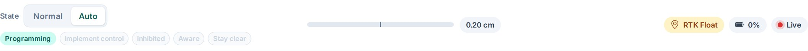

   **Figure 1.** Status bar

+ The *state selector* shows the navigation state (e.g. normal or auto, as defined in the ``auto_modes`` of the ``settings.json`` file). Tap another state to switch the robot to it.
+ The *substate chips* highlight the current PLC substate: Programming, Implement control, Inhibited, Aware or Stay clear (see :ref:`basic_concepts_robot_status`).
+ The *cross-track error gauge* shows how far the robot is beside the traject.
+ The *GPS chip* |icon_compass| shows the GNSS fix (green: RTK fix, orange: float, red: no fix).
+ The *battery chip* shows the remaining charge.
+ The *live heartbeat* |icon_heart_fill| pulses as long as the connection with the robot is alive.

Robot notifications appear in a notification box; closing it acknowledges the notification on the robot.

Fields
^^^^^^

The *Fields* page is the first page you see when browsing the web application.
It gives an overview of the available :ref:`fields <basic_concepts>`. The robot always works on exactly one selected field.

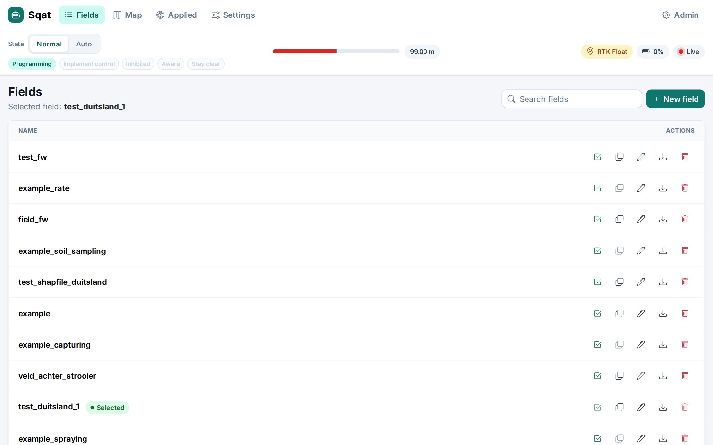

   **Figure 2.** Fields page

+ Select a field by clicking its name or the |icon_check| button.
+ Create a field with ``New field``.
+ Duplicate a field using the |icon_copy| button.
+ Edit a field by clicking on the |icon_pen| button.
+ Download a field as a ``.zip`` file (shapefiles and settings) by pressing the |icon_download| button.
+ Delete a field by clicking on the |icon_trash| button. The selected field cannot be deleted.

Edit field
^^^^^^^^^^

The field editor shows a side panel with the name, traject, geofence and tasks of the field, and a map with the shapes.

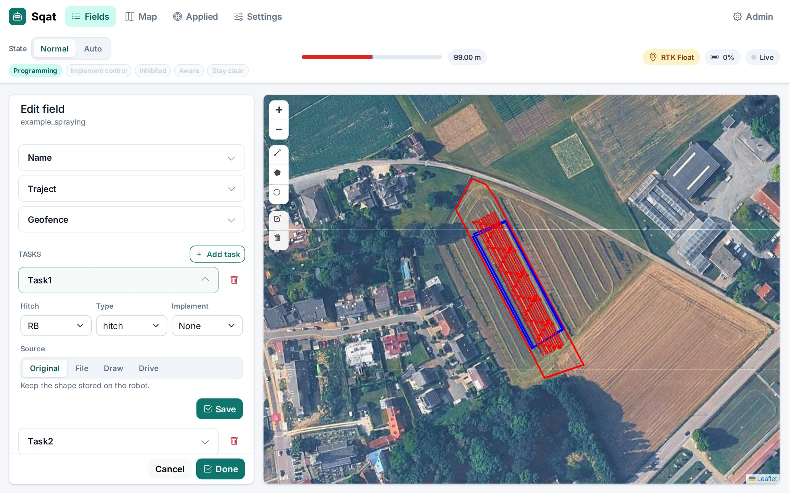

   **Figure 3.** Field editor

1. Change the name and press ``Save``. Names may only contain letters, digits and underscores.
2. Create the traject and the geofence. For each shape, choose its source and press ``Save``:

   + ``Original`` keeps the shape that is already stored on the robot.
   + ``File`` uploads a shapefile. Select all its parts together: ``.shp``, ``.shx``, ``.dbf`` and preferably ``.prj`` and ``.cpg``. The attributes and coordinate system of the file are kept.
   + ``Draw`` draws the shape with the drawing tools on the map.
   + ``Drive`` leaves the shape to be driven in later with the robot on the *Map* page.

3. Add one or more tasks with ``Add task``. Choose the *hitch*, the *task type* and the *implement*, and provide the task shape.
   An implement can only be chosen when it shares a task type with the hitch.
4. After a task is saved, its features are listed with their ``rate`` (continuous, cardan) or ``routine`` (discrete, intermittent). Edit the values and save the list.

``Done`` returns to the *Fields* page.

.. tip::

   Prepare large or precise shapes in QGIS and upload them as shapefiles, e.g. with the :ref:`sampling route generator <tools_sampling_route>`.

Map
^^^

The *Map* page shows the selected field and the robot with its hitches and implement sections, live.

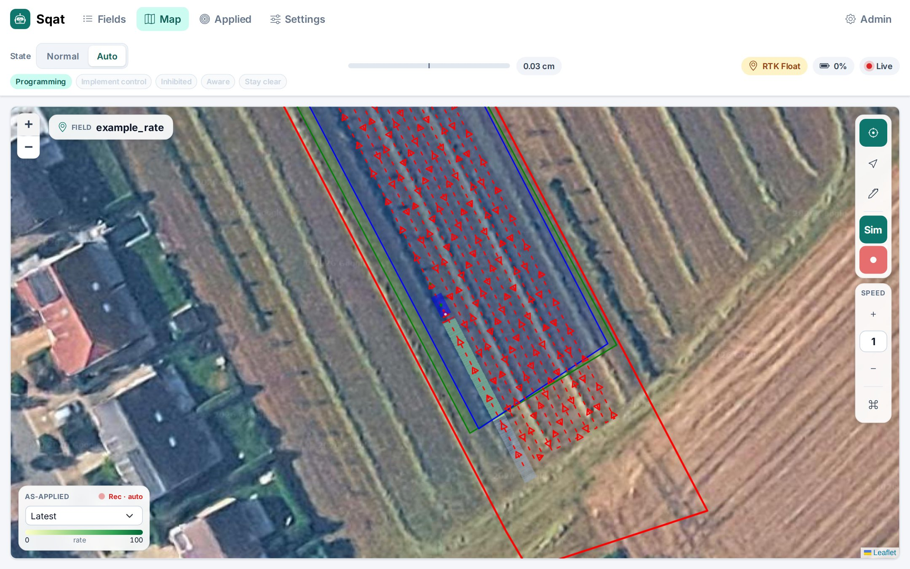

   **Figure 4.** Map page with the robot driving in auto mode, the swept sections and the as-applied panel

On the map you can see:

+ the traject: lines with arrows in the driving direction;
+ the geofence: the outline around the field;
+ the tasks, in the colour of their task;
+ the robot with its outline, hitches and sections. Active sections are highlighted;
+ the visualizations of the navigation algorithm: the robot reference, the closest point on the trajectory, and the look-ahead point.

The toolbar on the right contains:

+ |icon_crosshair| *Follow the robot*: keeps the robot in the centre of the map.
+ |icon_cursor| *Rotate with heading*: turns the map so that the robot always drives upwards.
+ |icon_pen| *Edit field*: opens the edit panel (see below).
+ ``Sim`` activates *simulation mode*. When the *operational layer* communicates with the *mechatronic layer*, the robot goes in *Hardware In The Loop (HIL) testing*; if not, you perform an *integration test* in the *operational layer*.

   + With the ``Speed`` factor (``+`` / ``−``, 0 to 32×) you can multiply the simulation speed.
   + The |icon_command| button lets you drive the simulated robot with the arrow keys, or place it with a click on the map.

+ The *record* button (red dot) starts or stops an :ref:`as-applied recording <basic_concepts_as_applied>`. It is disabled in auto mode, because recording then follows auto mode automatically.

The *As-applied* panel shows a recording on top of the field: the latest (running) session, a specific session, or none. ``Rec`` appears while a recording runs (``Rec · auto`` when it follows auto mode).

Editing shapes on site
""""""""""""""""""""""

The |icon_pen| edit panel corrects shapes in the field, for example to extend rows or shift them onto the real crop rows.

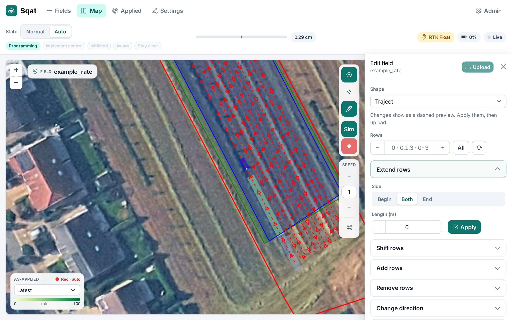

   **Figure 5.** Map edit panel with the traject selected

1. Choose the shape to edit: the traject, the geofence or one of the tasks.
2. Apply one or more operations. Each result is first shown as a dashed preview; press |icon_check| to accept it.
3. Press ``Upload`` to save the accepted changes to the field. Until then, nothing is stored.

Traject operations work on the rows in the ``Rows`` box: a single row (``0``), a list (``0,1,3``) or a range (``0-3``).

+ *Extend rows*: make the selected rows longer (negative: shorter) at the begin, the end or both.
+ *Shift rows*: move the selected rows sideways.
+ *Add rows*: add parallel rows next to the first or last row.
+ *Remove rows*: delete the selected rows.
+ *Change direction*: *Reverse* drives the rows in the opposite direction, *Flip* changes the order in which the rows are driven.
+ *Drive in*: record a new row with the robot. Drive to the start and press ``A``, press ``/`` at each waypoint and ``B`` at the end of the row.

For a geofence or polygon task, *Buffer* grows (positive distance) or shrinks (negative distance) the polygon.

Applied
^^^^^^^

The *Applied* page reviews :ref:`as-applied recordings <basic_concepts_as_applied>` after the work.

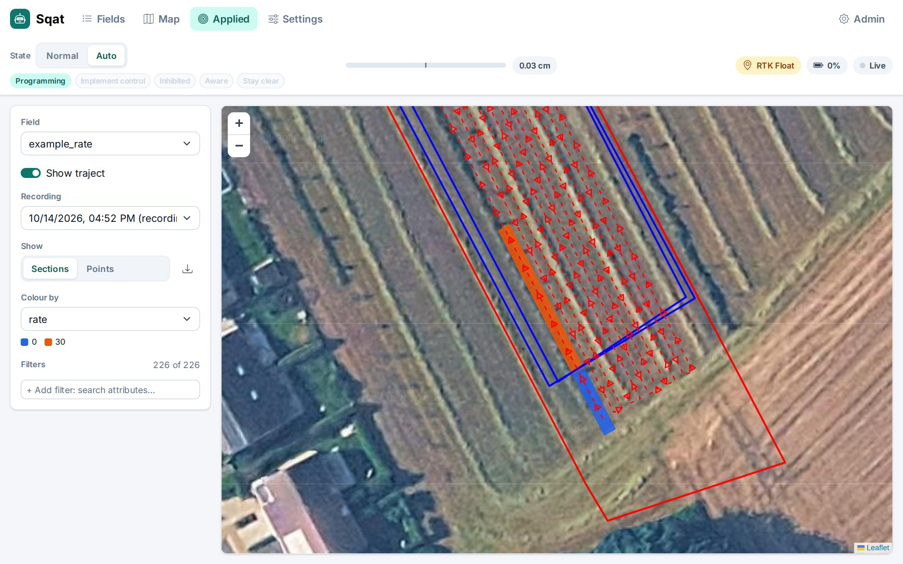

   **Figure 6.** Applied page with a recording coloured by rate

1. Choose the field and the recording (session). The running session is marked ``(recording)``.
2. Choose the layer: *Sections* (the area covered by each section, with its rate) or *Points* (the robot position log with all Redis variables).
3. Choose an attribute in *Colour by*, and optionally add filters on any attribute.
4. Click a feature on the map to see all its attributes.

The download button saves the recording as a GeoPackage (``.gpkg``) that opens directly in QGIS.

Settings
^^^^^^^^

The *Settings* page holds the settings an operator adjusts while working. Changes are applied as soon as you release a slider or change a selection.

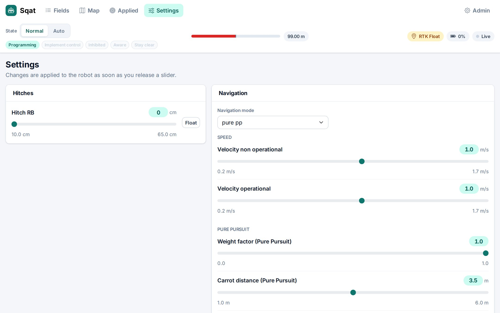

   **Figure 7.** Settings page

+ For every hitch: the height setpoint (cm) and, if provided by the robot's hardware, the ``Float`` mode.
+ The navigation mode, as explained in :ref:`basic_concepts_platform`.
+ The operational and non-operational velocity. The robot uses the operational velocity when it is in a task polygon; otherwise, it uses the non-operational velocity.
+ The navigation controller parameters (*Pure pursuit*, *Steady state* and *Rough*).

Admin area
^^^^^^^^^^

The *Admin* area is meant for the robot administrator. Its menu has *Settings*, *Implements*, *Processes*, *Addons* and *Monitor*.

The form editors (system settings, implements and add-ons) have a *Form | JSON* switch. Both modes edit the same data. Invalid content is refused with an error, and nothing is saved.

.. _addon_system_admin_settings:

Settings
""""""""

In the admin *Settings*, the :ref:`configuration files <basic_concepts>` can be edited:

+ ``settings.json`` (system settings) in a form editor with a live top and side preview of the robot and its hitches, or as JSON;
+ ``config.json`` and ``types.json`` in a JSON editor.

Hitch names are checked against the hitches in ``config.json``.

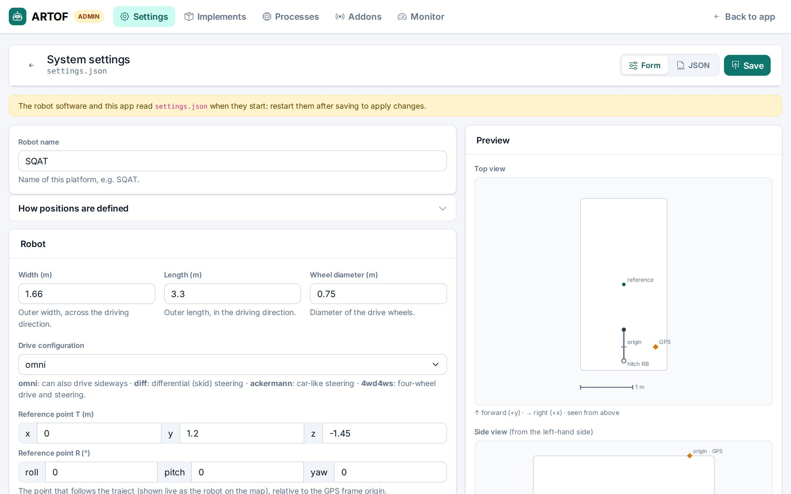

   **Figure 8.** Form editor of ``settings.json`` with the robot preview

.. note::
   Changes in the admin *Settings* require a restart of the robot (computer).

.. _addon_system_admin_implements:

Implements
""""""""""

You can add (|icon_plus|), edit (|icon_pen|) or delete (|icon_trash|) :ref:`implements <basic_concepts>`.
The implement editor shows the general settings and the sections on the left, and a top and side preview of the implement on a chosen hitch on the right.

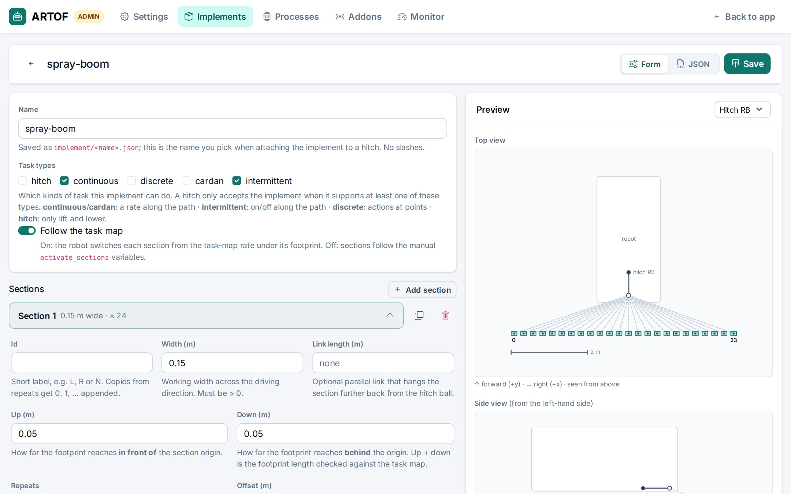

   **Figure 9.** Implement editor with its preview

.. note::
   When you are modifying an enabled implement in the selected field, you first need to toggle another field for the changes to occur.

Processes
"""""""""

The *Processes* page lists the processes of the operational layer with their start time and state.

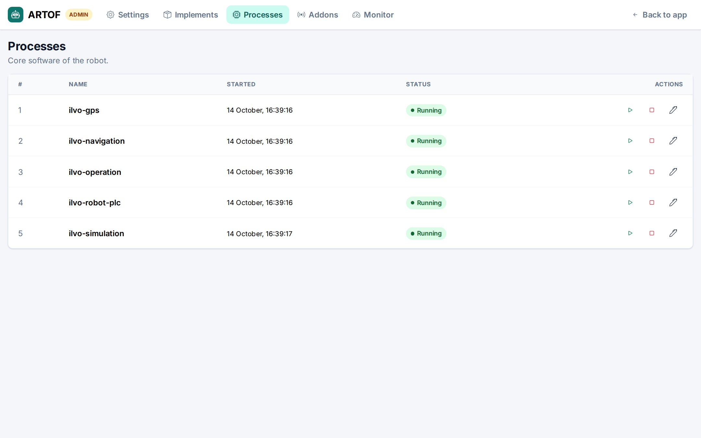

   **Figure 10.** Processes page

+ Start the process by pressing the |icon_play| button.
+ Stop the process by pressing the |icon_stop| button. Stopping a core process can stop the robot.
+ Show the process configuration (read only) by pressing the |icon_pen| button.

.. _addon_system_admin_addons:

Add-ons
"""""""

The *Addons* page lists the add-ons in the system with their start time and status.

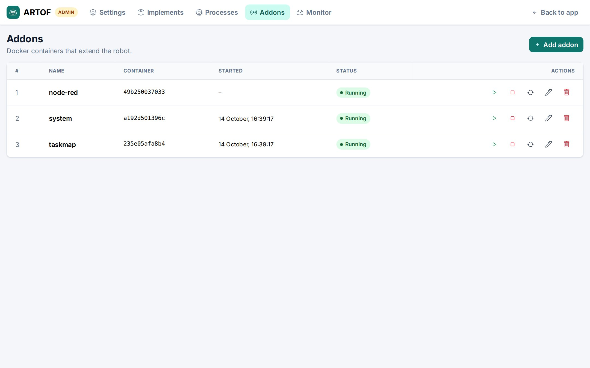

   **Figure 11.** Addons page

+ Add a new add-on using the |icon_plus| button.
+ Start the add-on by pressing the |icon_play| button (the image is pulled when needed).
+ Stop the add-on by pressing the |icon_stop| button.
+ Update the add-on by pressing the |icon_repeat| button. The latest image is pulled and the container is recreated.
+ Edit the add-on by pressing the |icon_pen| button.
+ Delete the add-on by pressing the |icon_trash| button.

The add-on editor sets the name (also the container name, cannot be changed later), *Start with the robot*, the Docker image, the shared folders, the environment variables, the network and restart policy, and the registry credentials for private images.
The side panel shows the add-on status and the equivalent ``docker run`` command.

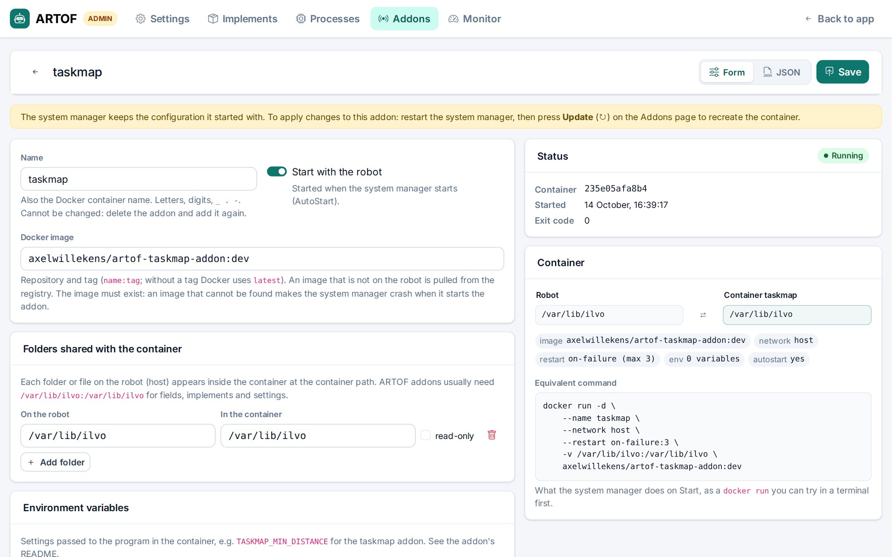

   **Figure 12.** Add-on editor for the task-map add-on

.. note::
   The add-on configuration uses the `Docker Engine API (1.46) <https://docs.docker.com/engine/api/v1.46/>`_ syntax.
   A configuration that would crash the system manager (no image, an image Docker cannot find, a container-name conflict) is refused.
   The system manager only uses a changed configuration after it restarts: restart it, then press |icon_repeat| on the *Addons* page.

Monitor
"""""""

The *Monitor* page shows all :ref:`Redis variables <basic_concepts_interfaces>` with their live value.

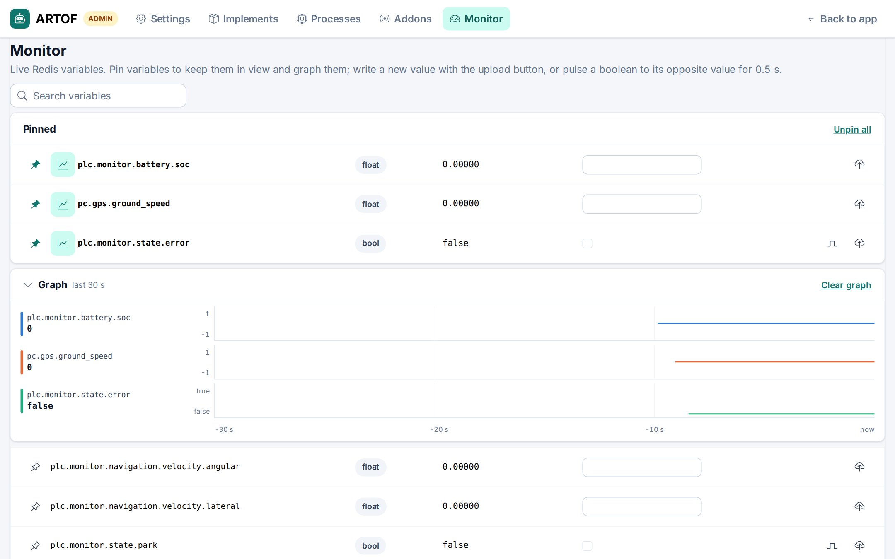

   **Figure 13.** Monitor page with pinned variables in the live graph

+ Search a variable with the search bar.
+ *Pin* a variable to keep it at the top. The pinned set is remembered by the browser.
+ *Graph* adds a numeric or boolean variable to the live graph of the last 30 seconds.
+ Write a value in the ``New value`` field and press |icon_upload_cloud|.
+ *Pulse* sets the opposite value of a boolean for 0.5 s and then restores it, like pressing a button.

.. note::

   Altering ``plc.monitor`` variables does not have any effect, as they are immediately updated again by the :cpp:class:`RobotPlc` process.
   Never write an empty string to a variable that the operational layer reads; use a placeholder such as ``-``.

.. _addon_node_red:

Node-red add-on
---------------

The node-red add-on provides flow programming, used for logging and implement interaction.
It can be reached at the URL http://<ip-robot>:1880/.
The add-on has access to the ``field`` and ``implement`` folders and the ``config.json``, ``settings.json`` and ``types.json`` files of the robot.

You can install the submodules for extracting the Redis variables and logging them to an InfluxDB instance by

*<Coming soon>*

.. _addon_taskmap:

Task-map add-on
---------------

The task-map add-on records :ref:`as-applied sessions <basic_concepts_as_applied>`.
While the Redis variable ``pc.as_applied.record`` is ``true``, it polls Redis and writes one session folder per recording.

+ Recording is switched on when the robot enters auto mode (a navigation state in ``auto_modes`` of ``settings.json``, or ``pc.simulation.auto`` in simulation) and off when it leaves it. Outside auto mode it can be toggled from the *Map* page.
+ A new session starts each time recording is switched on or the active field (``pc.field.name``) changes. The running session id is published in ``pc.as_applied.session``.
+ ``pc.as_applied.heartbeat`` (unix time, every second) tells the web pages the add-on is alive. Without it, the *Map* page shows *Task-map addon is not running*.
+ Sections and points are written once they moved more than ``TASKMAP_MIN_DISTANCE``; points are also logged every ``TASKMAP_POINT_PERIOD`` seconds while the robot stands still.

The source code is in the `artof-addon-taskmap <https://github.com/artof-ilvo/artof-addon-taskmap>`_ project.
Add it on the *Addons* page with the image ``axelwillekens/artof-taskmap-addon``, the ``host`` network and the folder ``/var/lib/ilvo`` shared with the container, or run it manually:

.. code-block:: bash

   docker run --rm --network=host -v /var/lib/ilvo:/var/lib/ilvo --name taskmap-addon axelwillekens/artof-taskmap-addon:dev

+---------------------------+---------+-----------------------------------------------------+
| Environment variable      | Default | Meaning                                             |
+===========================+=========+=====================================================+
| ``TASKMAP_POLL_PERIOD``   | 0.2     | Period (s) to poll Redis                            |
+---------------------------+---------+-----------------------------------------------------+
| ``TASKMAP_FLUSH_PERIOD``  | 1.0     | Period (s) to write the GeoPackages                 |
+---------------------------+---------+-----------------------------------------------------+
| ``TASKMAP_MIN_DISTANCE``  | 0.1     | Minimum distance (m) before a new feature is written|
+---------------------------+---------+-----------------------------------------------------+
| ``TASKMAP_POINT_PERIOD``  | 5.0     | Period (s) to log a point while standing still      |
+---------------------------+---------+-----------------------------------------------------+
| ``REDIS_HOST``,           |         | Redis server                                        |
| ``REDIS_PORT``            |         |                                                     |
+---------------------------+---------+-----------------------------------------------------+

.. Icons

.. |icon_crosshair| raw:: html
   :file: icons/crosshair.html

.. |icon_cursor| raw:: html
   :file: icons/cursor.html

.. |icon_pen| raw:: html
   :file: icons/pen.html

.. |icon_heart_fill| raw:: html
   :file: icons/heart-fill.html

.. |icon_copy| raw:: html
   :file: icons/copy.html

.. |icon_compass| raw:: html
   :file: icons/compass.html

.. |icon_download| raw:: html
   :file: icons/download.html

.. |icon_trash| raw:: html
   :file: icons/trash.html

.. |icon_check| raw:: html
   :file: icons/check2.html

.. |icon_command| raw:: html
   :file: icons/command.html

.. |icon_upload| raw:: html
   :file: icons/upload.html

.. |icon_upload_box| raw:: html
   :file: icons/box-arrow-in-up.html

.. |icon_upload_cloud| raw:: html
   :file: icons/cloud-upload.html

.. |icon_json| raw:: html
   :file: icons/json.html

.. |icon_plus| raw:: html
   :file: icons/plus.html

.. |icon_stop| raw:: html
   :file: icons/stop.html

.. |icon_play| raw:: html
   :file: icons/play.html

.. |icon_repeat| raw:: html
   :file: icons/arrow-repeat.html