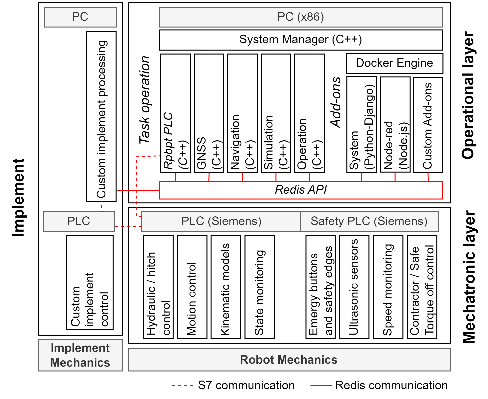

Architecture
============

Overview
--------

The ARTOF framework is composed out of two layers.
The mechatronic layer provides motion control and machine safety and the operational layer enables the autonomous task map execution.
The add-ons provide additional functionality, behind the scope of the core functionality.
The ARTOF Redis API maintains the communication between the operational layer, the add-ons and other network devices or implements.
The framework architecture is shown in the figure below.

#. The **mechatronic layer** is designed to control the hardware components, integrate the inverse and direct kinematic models, interact with the remote controller, enable hitch operation, interface with implements, and interact with the Safety Related Parts of the Control System (SRP/CS). Its integration of the machine safety state diagram ensures a secure operation. The layer can be implemented in different technologies. At ILVO Siemens® technology is used, providing the required flexibility and industrial graded performance.

#. The **operational layer** provides the real-time autonomous task map execution based on GNSS navigation. The processes of the operational layer run on a computer and are implemented in CPlusPlus (C++).

#. The **add-ons** provide additional functionality. Add-ons are configured in Docker® containers. The system is shipped by default with

   + the *system add-on* that provides a web app for user interaction, and
   + the *node-red add-on* that provides flow programming functionality, used for logging and implement interaction.

   Other add-ons, such as the *task-map add-on* (as-applied recording), can be added in the system add-on web app. See :ref:`addons`.

Software projects
-----------------

The framework is split over several projects in the `artof-ilvo <https://github.com/artof-ilvo>`_ GitHub organization.

.. list-table::
   :header-rows: 1
   :widths: 30 70

   * - Project
     - Content
   * - `artof-core <https://github.com/artof-ilvo/artof-core>`_
     - C++ processes of the operational layer, shipped as the ``artof-core`` Debian package and the ``artof-core`` Docker image
   * - `artof-system <https://github.com/artof-ilvo/artof-system>`_
     - Django web app of the system add-on
   * - `artof-utils <https://github.com/artof-ilvo/artof-utils>`_
     - Python package (``artof_utils`` on PyPI) for Python add-ons
   * - `artof-addon-taskmap <https://github.com/artof-ilvo/artof-addon-taskmap>`_
     - Task-map add-on: records as-applied sessions (see :ref:`addon_taskmap`)

Communication
-------------

ARTOF Redis interface
^^^^^^^^^^^^^^^^^^^^^

The in-memory database `Redis® <https://redis.io/>`_ was selected to perform the interprocess communication between the real-time processes in the operational layer and inter-network communication between other implements or remote operators.

Mechatronic-operational layer interface
^^^^^^^^^^^^^^^^^^^^^^^^^^^^^^^^^^^^^^^

Two protocols are supported for the *mechatronic-operational layer interface*:

+ ``s7``: the `Siemens S7-communication protocol (Snap7) <https://snap7.sourceforge.net/>`_. The PLC maintains a ``higherLevelMonitor`` and ``higherLevelControl`` data block that are read and written at every program cycle.
+ ``udp``: the control and monitor variables are exchanged as UDP messages (with a 20-byte header) on a read and a write port.

The protocol is selected in the ``protocols.plc`` object of the ``config.json`` file.
This interface functionality is implemented in the C++ class :cpp:class:`RobotPlc`. This class also enables the implementation of other interfaces, depending on the technology used in the mechatronic layer.

You can find more information on the *mechatronic-operational layer interface* in :ref:`Basic concepts (Interfaces) <basic_concepts_interfaces>`.

.. note::
   When using the ``s7`` protocol with a Siemens® PLC, the checkbox ``Permit Access with PUT/GET Communication from Remote Partner`` need to be set.
   This is described in the `Siemens documentation <https://cache.industry.siemens.com/dl/files/115/82212115/att_108330/v2/82212115_s7_communication_s7-1500_en.pdf>`_.
