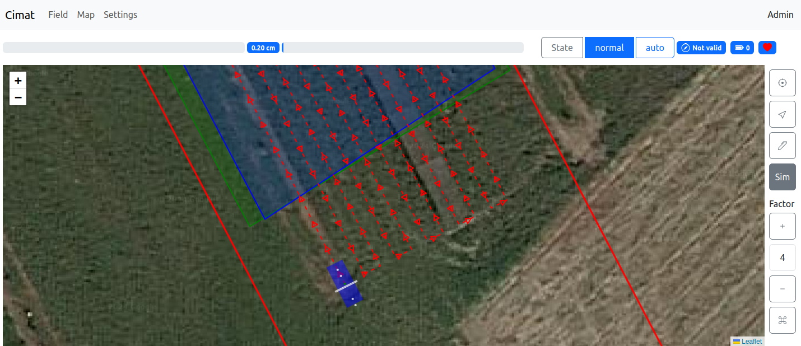

Installation
============

ARTOF can be installed in two ways:

+ A :ref:`installation_system` installation from the signed ARTOF APT repository. This is the preferred installation when integrating the framework on a robot platform.
+ A :ref:`installation_docker` installation that runs the whole stack in containers, without installing anything on the host. This is useful for testing or developing the framework.

.. _installation_system:

System
------

Requirements
^^^^^^^^^^^^

+ **Ubuntu 24.04 (arch: amd64)**, connected to the internet. The packages are built against the Ubuntu 24.04 libraries and do not install on other releases.

Install a new robot
^^^^^^^^^^^^^^^^^^^

Set up a new robot once with the bootstrap script:

.. code-block:: bash

	# stable channel
	curl -fsSL https://minio.ilvo.be:9000/tv115-ilvo-robotics/bootstrap.sh | sudo sh
	# dev channel (follow the development builds)
	curl -fsSL https://minio.ilvo.be:9000/tv115-ilvo-robotics/bootstrap.sh | sudo sh -s -- dev

The bootstrap installs Docker if needed, adds the signed ARTOF package repository and installs the ``artof-core`` package.
The package installs

+ the ``ilvo-robotics`` service, which runs the :ref:`system manager <system_manager>`,
+ a pinned Redis container (``redis-stack-server``),
+ the default configuration in ``/var/lib/ilvo`` (``ILVO_PATH``).

The robot settings in ``/var/lib/ilvo`` are never overwritten: the defaults from ``/usr/share/artof-core/defaults`` are only copied when missing.

Update a robot
^^^^^^^^^^^^^^

.. code-block:: bash

	artof-update            # newest version
	artof-update --list     # available versions
	artof-update <version>  # install a specific version, also to roll back

.. warning::

   An update restarts the ``ilvo-robotics`` service and empties Redis, so the system manager reloads ``redis.init.json``.
   Do not update during a field job.

Running a robot
^^^^^^^^^^^^^^^

.. code-block:: bash

	systemctl status ilvo-robotics             # is the stack running?
	sudo systemctl restart ilvo-robotics       # restart all processes
	sudo systemctl stop ilvo-robotics          # stop all processes
	journalctl -u ilvo-robotics -f             # service output
	ls /var/lib/ilvo/logs                      # one log file per process
	dpkg-query -W artof-core                   # installed version

Uninstall
^^^^^^^^^

Each step goes further; stop after the one you need.

1. Remove the software. This stops and disables the service, but keeps the settings in ``/var/lib/ilvo``, so a later ``sudo apt install artof-core`` continues where it left off.

.. code-block:: bash

	sudo apt remove artof-core

2. Remove the Redis container and the add-on containers started by the system manager (not all of them may exist). Add ``docker image prune -a`` to also free the image disk space.

.. code-block:: bash

	docker rm -f redis-stack-server system node-red

3. Remove the robot data: settings, fields, implements and logs. This cannot be undone, so make a backup first.

.. code-block:: bash

	sudo tar czf ~/ilvo-backup.tgz /var/lib/ilvo
	sudo rm -rf /var/lib/ilvo

4. Remove the ARTOF package repository.

.. code-block:: bash

	sudo rm /etc/apt/sources.list.d/artof.sources /etc/apt/keyrings/artof.gpg
	sudo apt update

Docker, ``curl`` and ``gpg`` installed by the bootstrap are left in place because other software may use them.

.. _installation_docker:

Docker
------

Install `Docker <https://docs.docker.com/engine/install/ubuntu/>`_ with `root-level privileges <https://docs.docker.com/engine/install/linux-postinstall/>`_ first.
You may have to reboot after installation.

The ``ilvo`` folder of the `artof-core <https://github.com/artof-ilvo/artof-core>`_ project runs the whole stack in Docker:

.. code-block:: bash

	git clone https://github.com/artof-ilvo/artof-core.git
	cd artof-core/ilvo
	docker compose up -d

The ``ilvo/data`` folder is mounted as ``ILVO_PATH``. It contains the same files as the package defaults, with these differences:

+ ``config.json``: Redis is reached at ``"ip": "redis"``, the compose service name, instead of ``127.0.0.1``.
+ ``redis.init.json``: the add-on containers mount the host data folder in ``HostConfig.Binds``, join the compose network through ``HostConfig.NetworkMode`` (``ilvo_artof_network``) and publish their ports through ``ExposedPorts`` and ``HostConfig.PortBindings``.

The first time, it can take some time for ``artof-core`` to pull and install the system and node-red add-on.
The output of the ``artof-core`` container shows how the add-ons are launching.

.. note::
   When updating to a new version, clear the Redis cache, so the new ``redis.init.json`` is loaded.
   Remove the ``redis_data`` volume or run ``redis-cli FLUSHALL``.

Check your installation
-----------------------

Browse to the *system add-on web app* at `http://<ip-robot> <http://localhost>`_ (port 80 by default, set by the ``PORT`` environment variable of the add-on).

Next, browse to the *Map* tab and press the ``Sim`` button. You should see the robot appear as shown in *Figure 1*.

	**Figure 1.** Map tab: First view of the robot in the system add-on

Thereafter, check the *node-red add-on* installation at `http://<ip-robot>:1880 <http://localhost:1880>`_.

Troubleshooting
^^^^^^^^^^^^^^^

+ **The service does not start**: it waits up to 60 s for Redis. Check ``redis-cli ping`` (expects ``PONG``) and ``docker ps`` for the ``redis-stack-server`` container.
+ **Changes to redis.init.json are not applied**: the file is only read into an empty Redis. Stop the service, run ``redis-cli FLUSHALL`` and start it again.
+ **No PLC data**: check that the PLC answers on the IP in ``config.json`` and that the protocol settings match the PLC (see :ref:`basic_concepts_interfaces`).

Additional hardware configuration
---------------------------------

SimpleRTK3b GPS
^^^^^^^^^^^^^^^

1. Connect to USB ethernet (dhcp) and write the ip `192.168.3.1 <http://192.168.3.1>`_ in your browser.

2. In tab ``Corrections`` ``Corrections Input``, set ``USB1`` to ``RTCMv3``

3. In tab ``NMEA/SBF Out`` add ``New NMEA stream`` set ``USB1`` to ``GGA+VTG+HDT+HRP`` and specify your interval.

4. On your computer you need to add yourself to the dialout group ``sudo usermod -a -G dialout <your-username>`` and reboot.

5. Configure automatic symlink creation for a ``/dev/ttyACMx`` to ``/dev/septentrio0``. Therefore paste the following in the file ``/etc/udev/rules.d/99-septentrio.rules``:

.. code-block:: bash

	sudo vim /etc/udev/rules.d/99-septentrio.rules

.. code-block:: bash

	# SEPTENTRIO (names are not loaded in lsusb, use ENV variables of udevadm)
	SUBSYSTEM=="tty", ACTION=="add", ENV{ID_VENDOR_ID}=="152a", ENV{ID_MODEL_ID}=="85c0", ENV{ID_USB_INTERFACE_NUM}=="02", SYMLINK+="septentrio0"
	SUBSYSTEM=="tty", ACTION=="add", ENV{ID_VENDOR_ID}=="152a", ENV{ID_MODEL_ID}=="85c0", ENV{ID_USB_INTERFACE_NUM}=="04", SYMLINK+="septentrio1"

Set ``"device": "serial"`` and ``"usb_port": "/dev/septentrio0"`` in the ``gps`` object of the ``settings.json`` file.

Stonex GPS
^^^^^^^^^^

A Stonex receiver is connected over Ethernet.
Set ``"device": "socket"`` with the receiver ``ip`` and ``udp_port`` in the ``gps`` object of the ``settings.json`` file.

Enable ssh
^^^^^^^^^^

To enable ssh execute the following commands:

.. code-block::

	sudo apt update
	sudo apt install openssh-server -y
	sudo systemctl status ssh

Remote connection
^^^^^^^^^^^^^^^^^

To access the robot framework remotely, you can configure a VPN connection (e.g. `tailscale <https://tailscale.com/kb/1031/install-linux>`_).

Common issues
-------------

Ethernet over USB of the SimpleRTK3b module on a NUC
^^^^^^^^^^^^^^^^^^^^^^^^^^^^^^^^^^^^^^^^^^^^^^^^^^^^

The Septentrio chip of the SimpleRTK3b GPS modules provides ethernet over USB. This can cause problems on boot time as this USB network device may be selected in favor of the PCI network device. This guide provides a step-by-step approach to create a `systemd` service file that ensures the specified PCI network device is automatically connected at boot time using `nmcli`. The provided instructions use `systemd`, a system and service manager for Linux operating systems, to execute the NetworkManager command line interface (``nmcli``) once the network is online.

1. Open a Terminal: ``Ctrl-Alt-t``

2. Create Service File: Use a text editor with root permissions to create a new systemd service file. You can use ``nano`` or ``vim`` or any other text editor.

.. code-block:: bash

	sudo vim /etc/systemd/system/connect-network.service

3. Add Service Configuration: Copy the following content into the newly created service file. Replace `<network device>` with the network device identifier you intend to connect.

.. code-block:: ini

	[Unit]
	Description=Connect to a specific network device at boot
	After=network-online.target
	Wants=network-online.target

	[Service]
	Type=oneshot
	ExecStart=/usr/bin/nmcli dev connect <network device>
	RemainAfterExit=yes

	[Install]
	WantedBy=multi-user.target

4. Enable and start the service

.. code-block:: bash

	sudo systemctl enable connect-network.service
	sudo systemctl start connect-network.service
