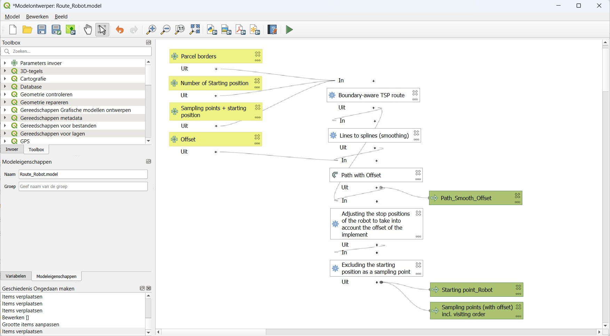
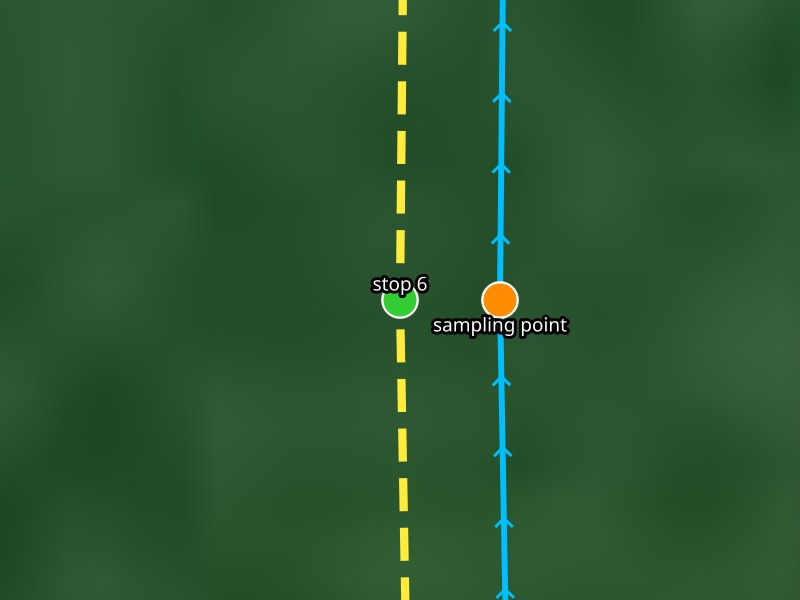
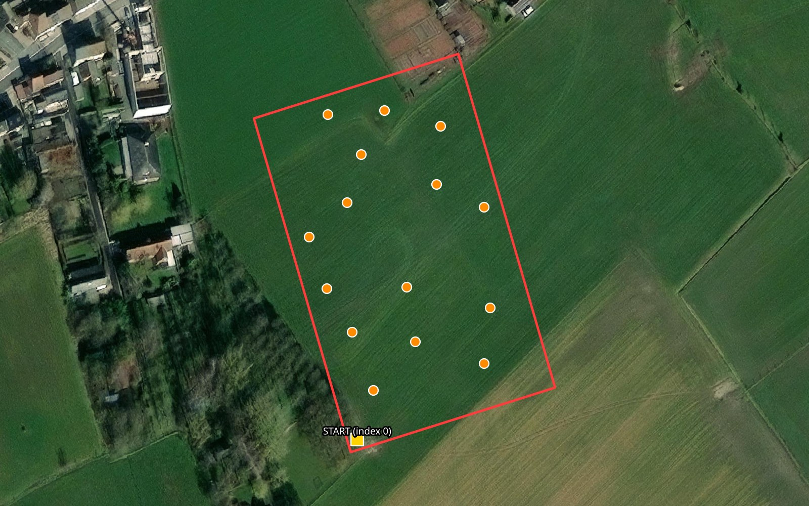
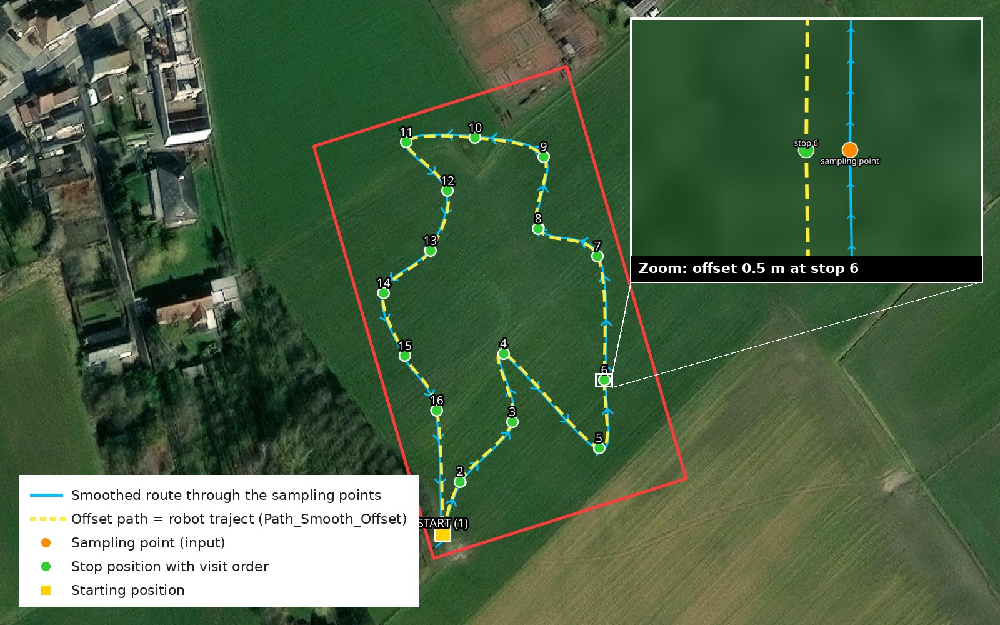

Tools
=====

.. _tools_sampling_route:

Sampling route generator (QGIS)
-------------------------------

``Route_Robot`` is a QGIS processing model (``Route_Robot.model.model3``) that prepares a sampling job for an ARTOF robot.
From a parcel boundary and a layer of sampling points it computes

+ the shortest round trip along the sampling points that stays inside the parcel (a Travelling Salesman Problem, TSP);
+ a smooth path for the robot along that route, shifted sideways by the offset of the implement;
+ the stop positions on that path, so that the implement is exactly above each sampling point when the robot stops;
+ the starting point of the robot.

The model is used for point-based (*discrete*) sampling implements, such as a top soil sampler, a soil profile sampler or a vertical penetrometer.

Requirements
^^^^^^^^^^^^

+-------------------+--------------------------------+------------------------------------------------------------------+
| Software          | Version                        | Purpose                                                          |
+===================+================================+==================================================================+
| QGIS              | 3.22 or newer (tested on 3.44) | Runs the model                                                   |
+-------------------+--------------------------------+------------------------------------------------------------------+
| Plugin *Plover*   | 3.2.5 or newer                 | Boundary-aware TSP route (``plover:tsproute``)                   |
+-------------------+--------------------------------+------------------------------------------------------------------+
| Plugin *Spline*   | 0.2 or newer                   | Lines to splines (``spline:lines2splines``)                      |
+-------------------+--------------------------------+------------------------------------------------------------------+

Install the plugins in *Plugins → Manage and Install Plugins…*. Then add the model in the *Processing Toolbox* with *Models → Add Model to Toolbox…*.

How the model works
^^^^^^^^^^^^^^^^^^^

   **Figure 1.** The ``Route_Robot`` model in the QGIS model designer

#. **Boundary-aware TSP route** finds the shortest round trip from the starting position along every sampling point and back, without leaving the parcel (0.5 m margin). Holes in the parcel are no-go zones.
#. **Lines to splines** turns the angular route into a smooth curve the robot can follow.
#. **Offset line** shifts the smooth path sideways by the *offset*, the lateral distance between the robot reference point and the sampler. A positive offset shifts the path to the left of the driving direction, for an implement on the right-hand side.
#. **Snap geometries** moves every point onto the offset path: the stop positions.
#. **Extract by expression** splits off the starting position (``visit_order`` 1) from the sampling points.

   **Figure 2.** Detail at one sampling point: the robot follows the offset path and stops beside the sampling point, so the implement is above it

Input and output
^^^^^^^^^^^^^^^^

All layers must use a projected coordinate system in meters, the UTM zone of the robot (e.g. EPSG:32631 for UTM zone 31N in Belgium).

+-------------------------------------+---------+------------------------------------------------------------------------+
| Input                               | Type    | Description                                                            |
+=====================================+=========+========================================================================+
| Parcel borders                      | Polygon | The border of the parcel                                               |
+-------------------------------------+---------+------------------------------------------------------------------------+
| Sampling points + starting position | Point   | All sampling points plus one extra point where the robot starts/ends   |
+-------------------------------------+---------+------------------------------------------------------------------------+
| Number of starting position         | Number  | Index of the starting position in the point layer, counted from 0      |
+-------------------------------------+---------+------------------------------------------------------------------------+
| Offset                              | m       | Lateral offset of the implement, e.g. 0.5                              |
+-------------------------------------+---------+------------------------------------------------------------------------+

   **Figure 3.** Example input: parcel border, sampling points and the starting position

+-----------------------------------------------------+-------+------------------------------------------------------------+
| Output                                              | Type  | Content                                                    |
+=====================================================+=======+============================================================+
| ``Path_Smooth_Offset``                              | Line  | The smooth, offset round trip: the robot's **traject**     |
+-----------------------------------------------------+-------+------------------------------------------------------------+
| ``Sampling points (with offset) incl. visiting      | Point | The stop positions with ``visit_order``, ``source_fid`` and|
| order``                                             |       | ``leg_length``: the robot's **discrete task**              |
+-----------------------------------------------------+-------+------------------------------------------------------------+
| ``Starting point_Robot``                            | Point | The starting position on the path (optional)               |
+-----------------------------------------------------+-------+------------------------------------------------------------+

   **Figure 4.** Example result: the smoothed route, the offset path and the numbered stop positions

Loading the result into the robot
^^^^^^^^^^^^^^^^^^^^^^^^^^^^^^^^^

1. Save ``Path_Smooth_Offset`` and the sampling points as *ESRI Shapefile* in the UTM coordinate system of the robot, e.g. ``traject.shp`` and ``samples.shp``.
2. In the :ref:`system add-on web app <addon_system>`, create a new field.
3. Upload ``traject.shp`` as the *traject* and the parcel border as the *geofence* (source ``File``, select all parts of the shapefile).
4. Add a task with the hitch of the sampler, the type ``discrete`` and the sampling implement, and upload ``samples.shp``.
5. Check on the map that the traject, the stops and the implement line up, and test the route in simulation before driving it with the robot.
